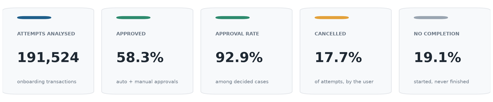
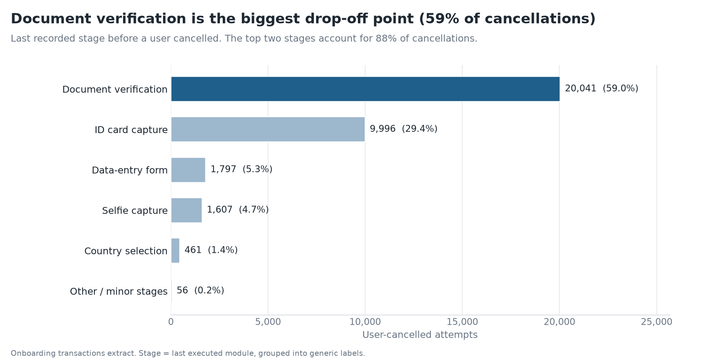
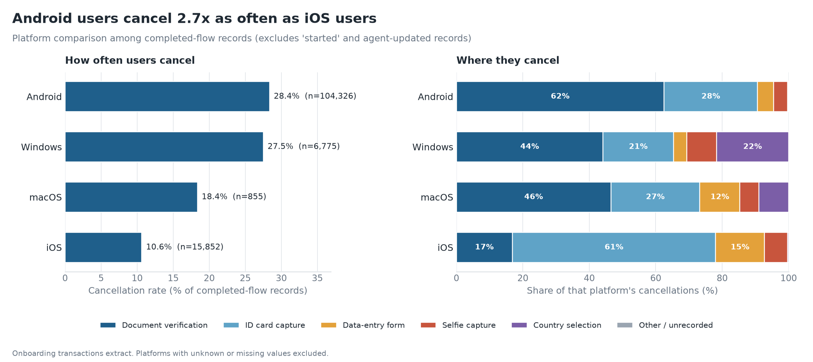

# KYC & Digital Onboarding Funnel Analytics

End-to-end analysis of **191,524 digital KYC onboarding transactions**: where customers
drop off, which platforms struggle, and how reliable the underlying data is.
Built with Python, pandas, SQL and automated tests.



> **Data note:** the source data is confidential and is not in this repository. All company
> and provider names are anonymised. Published charts contain aggregates only. A synthetic
> data generator lets anyone run the full pipeline (see [Quick start](#quick-start)).

## Key findings

| | Finding |
|---|---|
| 1 | **37% of onboarding attempts never reach a decision** (17.7% cancelled, 19.1% started but never finished) |
| 2 | **88% of cancellations happen at the two document steps**: document verification (59%) and ID card capture (29%) |
| 3 | **Android users cancel 2.7x as often as iOS users** (28.4% vs 10.6%), and at a different step |
| 4 | When a decision is made, **92.9% are approvals**; **12.5% of attempts** need a human agent |
| 5 | **Approval share fell from 61% to 56%** between early and late March as volume rose |

Full evidence, caveats and recommendations: **[reports/insights_report.md](reports/insights_report.md)**





## What this project demonstrates

- **Data reconciliation:** compared transaction IDs across six extracts *without exporting
  any identifier*, and found that one extract is a pure duplicate and another is probably
  truncated at Excel's row limit ([chart](reports/figures/07_dataset_reconciliation.png)).
- **Fail-fast data validation:** the loader rejects duplicate or missing IDs, missing
  columns and unexpected statuses instead of producing quietly wrong numbers.
- **Two independent implementations, cross-checked:** every key metric is computed in
  pandas *and* in SQL, and the pipeline asserts they agree.
- **Privacy by design:** private filenames and provider keywords live only in git-ignored
  config; a checker fails the build if data or local config is ever tracked.
- **Honest analysis:** every finding states what it cannot show; unverified assumptions
  are listed in [docs/methodology.md](docs/methodology.md).
- **Notebooks that explain the work:** an analytical walkthrough (including a significance test for
  the Android/iOS gap) and a data-quality notebook that breaks the data on purpose to show the
  validation rules. Both run on synthetic data.
- **BI-ready, privacy-safe export:** the dashboard data is an aggregated cube with no
  identifiers, verified to match source totals, with a documented model, DAX measures and theme
  ([powerbi/](powerbi/README.md)).
- **Testing and CI:** automated tests on synthetic data, run on every push by GitHub Actions.

## Quick start

Requires Python 3.11+ (developed on 3.12). Linux, macOS or WSL:

```bash
git clone <this-repo-url>
cd kyc-digital-onboarding-analytics

make setup     # creates .venv and installs dependencies
make test      # runs the automated tests
make demo      # full pipeline on synthetic data -> data/processed/synthetic/
```

No `make`? The equivalent commands are:

```bash
python3 -m venv .venv
source .venv/bin/activate
pip install -r requirements.txt
python -m pytest
python -m src.pipeline --source synthetic
```

`make demo` writes summaries, SQL results, charts (labelled *SYNTHETIC DEMO DATA*) and the Power BI
data model to `data/processed/synthetic/`.

### Notebooks

```bash
make setup-notebooks          # adds JupyterLab
.venv/bin/jupyter lab notebooks/
```

| Notebook | What it shows |
|---|---|
| [`01_onboarding_funnel_exploration`](notebooks/01_onboarding_funnel_exploration.ipynb) | Outcomes, drop-off, platform comparison with a significance test, trend |
| [`02_data_quality_and_validation`](notebooks/02_data_quality_and_validation.ipynb) | Validation rules failing on purpose, cleaning decisions, reconciliation method, SQL vs pandas check |

Saved outputs are from synthetic data. Re-run them with `make notebooks`.

### Running on your own (private) data

1. Put the CSV extracts in `data/raw/`.
2. Copy `config/dataset_manifest.example.json` to `config/dataset_manifest.local.json` and
   set each `file` to your filename.
3. Optional: copy `config/stage_mapping.example.json` to `config/stage_mapping.local.json`
   and add keywords for your own module names.
4. Run `make real`. Charts are written to `reports/figures/`.

Local config files are git-ignored. Run `make check-privacy` before every push.

## Repository structure

```text
config/                 example config (committed); *.local.* files are git-ignored
data/                   raw/, processed/, synthetic/  (contents git-ignored)
docs/                   data_dictionary.md, data_model.md, methodology.md
notebooks/              two executed notebooks (synthetic data)
powerbi/                dashboard build guide, DAX measures, theme
reports/                insights_report.md, data_quality_assessment.md, figures/
sql/                    schema/, views/, analysis/   (portable ANSI-style SQL)
scripts/                check_public_safety.py
src/
  config.py             paths, manifest and stage-mapping loaders
  pipeline.py           end-to-end entry point
  preprocessing/        profiling and data-dictionary generation
  analysis/             funnel, behaviour, reconciliation, investigation
  data_generation/      synthetic dataset generator
  database/             SQLite runner + SQL-vs-pandas verification
  export/               privacy-safe Power BI data model
  visualization/        chart generation
tests/                  pytest suite (synthetic data only)
```

## Documentation

| Document | Contents |
|---|---|
| [reports/insights_report.md](reports/insights_report.md) | Findings, caveats, recommendations |
| [docs/methodology.md](docs/methodology.md) | Pipeline, metric definitions, assumptions, limitations |
| [docs/data_model.md](docs/data_model.md) | Which extract is primary and why; grain; table design |
| [powerbi/README.md](powerbi/README.md) | Power BI data model, relationships, report pages, validation checklist |
| [powerbi/dax_measures.md](powerbi/dax_measures.md) | DAX measures |
| [docs/data_dictionary.md](docs/data_dictionary.md) | Anonymised dataset inventory and profiling results |
| [reports/data_quality_assessment.md](reports/data_quality_assessment.md) | Data-quality assessment |

## Limitations

One month of observational data. Findings describe *where* and *how much*, not *why*.
Several field definitions (time units, timezone, the meaning of "started") are unverified.
See [docs/methodology.md](docs/methodology.md#9-assumptions-unverified).

## Roadmap

- Build the Power BI dashboard (`.pbix`) from the prepared data model, measures and theme in
  [powerbi/](powerbi/README.md). The data export, model and DAX are ready; the `.pbix` itself is
  created in Power BI Desktop and is not yet in this repository
- Step-level conversion once stage-entry events are available
- PostgreSQL deployment of the SQL layer (written portably, currently run on SQLite)

## License

MIT. See [LICENSE](LICENSE).
