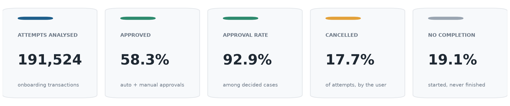
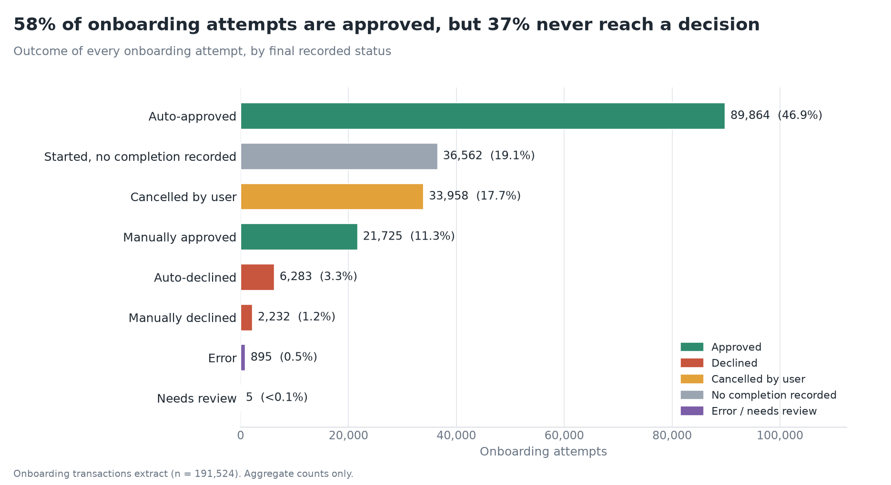
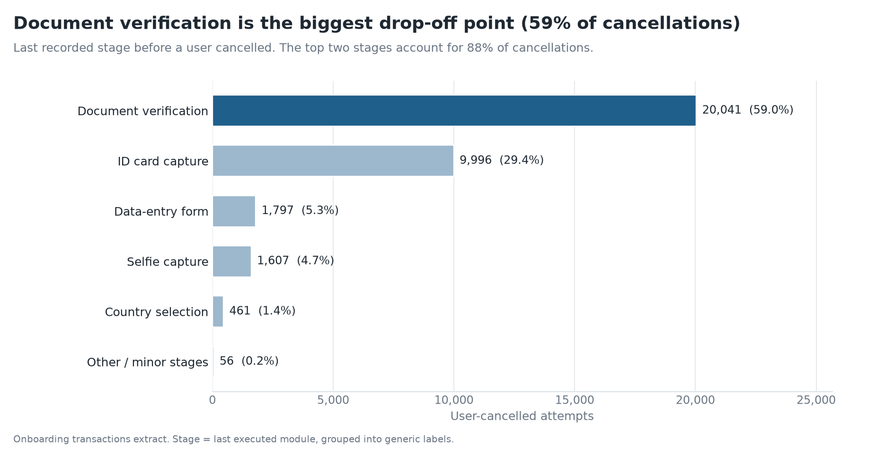
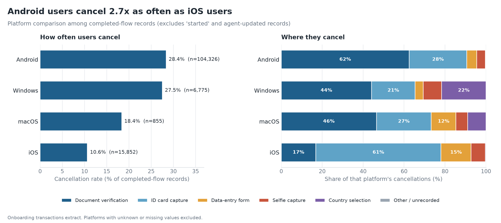
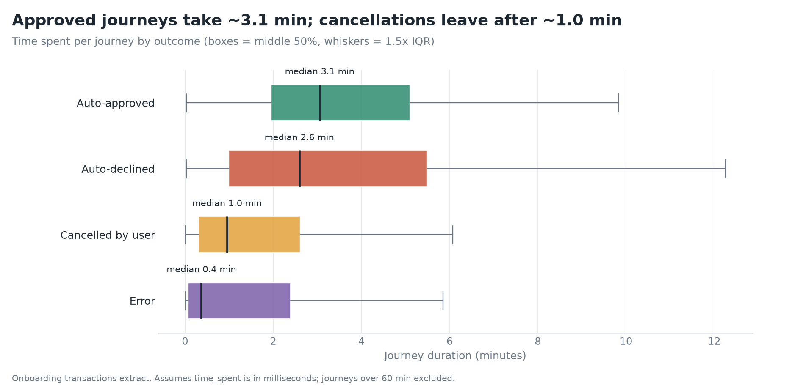
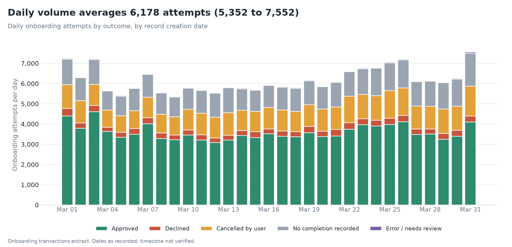
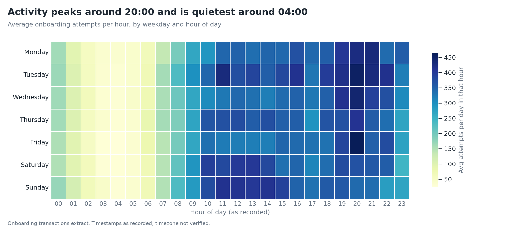
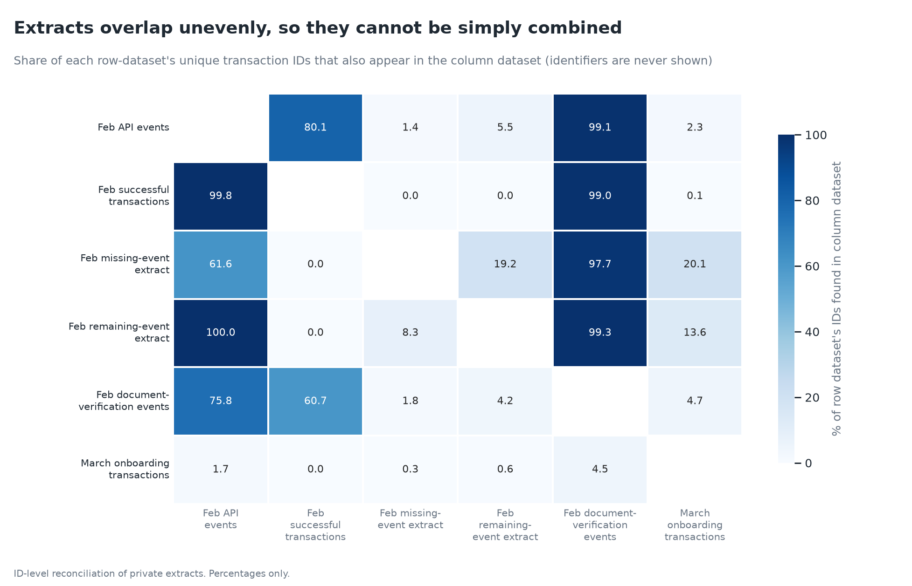

# Insights Report: Digital KYC Onboarding Funnel

**Scope:** 191,524 onboarding transactions created during March 2026 (one row per transaction).
**Data:** anonymised, private extract. Only aggregate results are published.
**Reproduce:** `make real` (private data) or `make demo` (synthetic data).

> All findings are **descriptive**. They show *where* and *how much*, not *why*.
> Each finding lists the caveats that limit how far it can be pushed.

---

## Executive summary

| # | Finding | Size |
|---|---|---|
| 1 | Roughly **1 in 3 onboarding attempts never reaches a decision** | 37.3% of attempts (cancelled 17.7%, started but never finished 19.1%, error 0.5%) |
| 2 | Almost all cancellations happen at the **document steps** | Document verification 59.0% + ID card capture 29.4% = 88.5% of cancellations |
| 3 | **Android users cancel 2.7x as often as iOS users**, and at a different step | 28.4% vs 10.6%; Android drops at document verification, iOS at ID card capture |
| 4 | The automated decisioning is **highly approving** when a decision is made | 92.9% of decided cases are approved |
| 5 | **12.5% of attempts need a human agent**, and 91% of those are approved | 23,957 agent decisions |
| 6 | **Approval share slipped through the month** while volume rose | 61.2% (Mar 1-10) to 56.2% (Mar 21-31) |

**Biggest opportunity:** the document-verification step on Android. It alone accounts for
about **18,500 cancellations**, roughly 54% of every cancellation in the dataset.

---

## 1. One in three attempts never reaches a decision

| Outcome | Attempts | Share |
|---|---:|---:|
| Approved (auto 89,864 + manual 21,725) | 111,589 | 58.3% |
| Declined (auto 6,283 + manual 2,232) | 8,515 | 4.4% |
| Cancelled by user | 33,958 | 17.7% |
| Started, no completion recorded | 36,562 | 19.1% |
| Error / needs review | 900 | 0.5% |

**Caveats**

- "Started" records have only a creation event. They could be abandoned journeys, or a
  tracking gap where the finishing event was never logged. The extract appears to have been
  taken some weeks after the period ended, so these are unlikely to be in-flight, but the
  data cannot separate abandonment from missing events.
- Headline approval rate is sensitive to the denominator: **58.3%** of all attempts,
  but **92.9%** of attempts that reached a decision. Always state which one you mean.

**Recommendation:** agree a business definition for "started, no completion" and log an
explicit abandonment/timeout event so it can be measured instead of inferred.

---

## 2. Cancellations concentrate at the document steps

| Last recorded stage | Cancellations | Share of cancellations |
|---|---:|---:|
| Document verification | 20,041 | 59.0% |
| ID card capture | 9,996 | 29.4% |
| Data-entry form | 1,797 | 5.3% |
| Selfie capture | 1,607 | 4.7% |
| Country selection | 461 | 1.4% |
| Other / minor | 56 | 0.2% |

Document verification alone represents **10.5% of all onboarding attempts**.

**Caveats**

- "Stage" is the *last executed module*. A user may have left while on that stage or
  on the one after it, so this indicates where journeys stop being recorded, not the
  exact screen where intent changed.
- Without stage **entry** counts, a per-stage conversion rate cannot be computed. The
  analysis shows where cancellations accumulate, not which stage is *least efficient per
  visitor*.

**Recommendation:** capture stage-entry and stage-exit events so per-step conversion can
be measured, then prioritise UX and reliability work on document verification.

---

## 3. Android vs iOS: different platform, different failure point

| Platform | Completed-flow records | Cancellation rate | Largest cancellation stage |
|---|---:|---:|---|
| Android | 104,326 | 28.4% | Document verification (62%) |
| Windows | 6,775 | 27.5% | Document verification (44%) |
| macOS | 855 | 18.4% | Document verification (46%) |
| iOS | 15,852 | 10.6% | **ID card capture (61%)** |

Android represents about 80% of completed-flow records, so its rate dominates the overall
cancellation figure. If Android matched iOS's cancellation rate, cancellations among
completed-flow records would fall by roughly 18,500 (an illustrative upper bound, not a
forecast).

**Caveats**

- Platform is correlated with device mix, user population, network conditions and SDK
  version. This analysis cannot separate those effects, so it **does not show that the
  Android app is the cause**.
- Only `finishTransaction` records are used, so "started" and agent-updated records do not
  distort the rate. Platforms recorded as missing/unknown (3,197 records) are excluded.
- macOS has under 1,000 records; treat its rate as indicative.

**Recommendation:** investigate the Android document-verification flow (error logs,
retries, device/OS breakdown). Separately examine why iOS users stall at ID card capture.

---

## 4. Decisions, when made, are overwhelmingly approvals

| Measure | Value |
|---|---:|
| Approval rate among decided cases | 92.9% |
| Auto-approved share of all attempts | 46.9% |
| Auto-declined share of all attempts | 3.3% |

Median journey duration: **3.1 min** for auto-approved, **2.6 min** for auto-declined, and
**1.0 min** for cancelled journeys. A quarter of cancelled journeys end within about 18
seconds, which suggests many exits happen almost immediately.

**Caveats**

- `time_spent` is **assumed to be in milliseconds**. This is plausible (a ~3-minute median)
  but unverified.
- 220 journeys longer than one hour were excluded as timing artefacts; 60,519 records
  (started and agent-updated) have no duration.

**Recommendation:** confirm the `time_spent` unit and definition with the data owner before
using durations for SLAs or targets.

---

## 5. The manual-review queue is large and mostly approves

| Agent decision | Records | Share of agent decisions | Share of all attempts |
|---|---:|---:|---:|
| Manually approved | 21,725 | 90.7% | 11.3% |
| Manually declined | 2,232 | 9.3% | 1.2% |

Agents approved **3.5x as many** applications as the system auto-declined (21,725 vs 6,283).

**Caveats**

- The reason a case reached an agent is **not available**: `review_decision_reasons` is
  100% empty in this extract, so routing rules cannot be analysed.
- Agent-updated records carry no platform or stage, so manual cases cannot be attributed
  to a platform or journey step.

**Recommendation:** capture the routing reason for every manual review. With it, thresholds
that send a large share of ultimately-approved cases to agents can be tested for tuning,
which would reduce cost and turnaround time.

---

## 6. Approval share slipped as volume grew

| Period | Attempts | Per day | Approved | Cancelled | No completion |
|---|---:|---:|---:|---:|---:|
| Mar 1-10 | 60,796 | 6,080 | 61.2% | 16.0% | 17.8% |
| Mar 11-20 | 58,096 | 5,810 | 57.7% | 18.1% | 19.4% |
| Mar 21-31 | 72,632 | 6,603 | 56.2% | 18.9% | 20.0% |

Daily volume averaged 6,178 attempts (range 5,352 to 7,552). The approval share fell by
5.0 percentage points between the first and last third of the month, mirrored by higher
cancellation and non-completion.

Activity peaks around **20:00** (about 415 attempts per hour on average) and is quietest
around **04:00** (about 30). Timestamps are as recorded; their timezone is unverified.

**Caveats**

- One month is not enough to distinguish a trend from normal variation or a seasonal
  effect. Causes (campaign traffic mix, a release, a provider issue) are unknown.

**Recommendation:** track weekly approval share and cancellation rate, and overlay release
and campaign dates. If the decline continues, segment by platform and stage to locate it.

---

## Data engineering findings

Transaction IDs were reconciled across six extracts without exporting any identifier.

- **The "remaining events" extract is entirely contained in the main API extract** (100%
  of its IDs). It adds no new transactions and should not be added to totals.
- **The "missing events" extract is only partly contained** in the main API extract
  (61.6%), but 97.7% of its IDs appear in the document-verification extract. It genuinely
  adds coverage and needs a defined role before use.
- **99.8% of successful transactions have a matching API event.** API event data is
  therefore a reliable companion for successful February transactions.
- **The document-verification extract holds exactly 1,048,575 rows**, the maximum an Excel
  worksheet can hold, so it was probably truncated. Coverage figures that rely on it are
  lower bounds.
- **March onboarding shares only 8,684 IDs (4.5%) with February document-verification
  events.** All 8,684 have a March creation time later than the February first event,
  consistent with a later re-attempt, though this is not proven.

**Decision:** the March onboarding extract (one row per transaction, 191,524 unique IDs) is
the primary analytical table. February extracts are used for reconciliation and coverage
checks only; overlapping extracts are never summed. See `docs/data_model.md`.

---

## Data quality issues found and handled

| Issue | Handling |
|---|---|
| 220 journeys over 60 minutes (some over a day) | Excluded from timing statistics, counted in `cleaning_log.csv` |
| One update count stored as `"1,599"` (thousands separator) | Parsed after stripping separators; counted in the cleaning log |
| Raw platform contains blanks | Normalised to a `missing` category, never silently dropped |
| Raw stage values are internal module identifiers | Mapped to generic labels through a local, git-ignored configuration |
| `review_decision_reasons` 100% empty, `country` 99.8% empty | Documented as unusable for analysis |

---

## Recommended next steps

1. **Fix measurement first:** add stage entry/exit events and an explicit abandonment event.
2. **Android document verification:** diagnose errors, retries and device/OS mix.
3. **iOS ID card capture:** review capture guidance and failure handling.
4. **Manual review:** record routing reasons, then test whether thresholds can be tuned.
5. **Monitor weekly:** approval share and cancellation rate, annotated with releases.
6. **Confirm definitions:** `time_spent` unit, timestamp timezone, meaning of "started".
7. **Re-export the document-verification extract** in a format without the 1,048,575-row limit.

## Limitations

Single month; observational data; no customer-level identifiers, so repeated attempts by
one person cannot be linked; business definitions for several fields are unverified and
are listed in `docs/methodology.md`.
